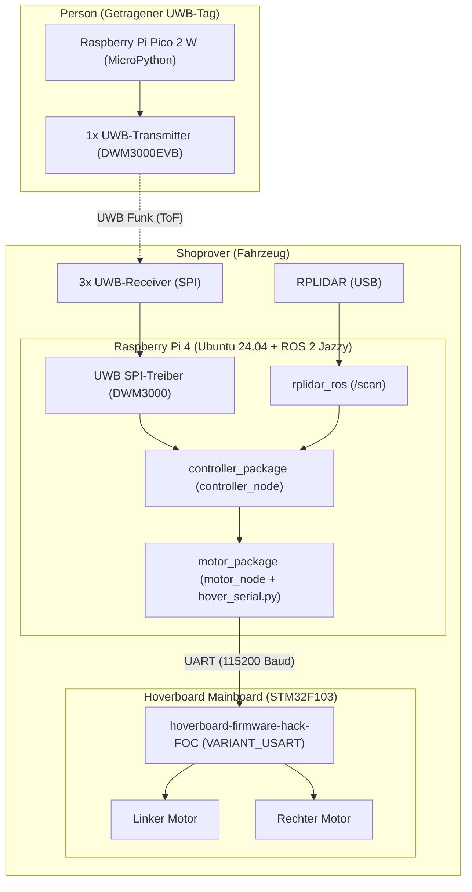

# Shoprover – Bau-, Flash- und Installationsanleitung (Build Guide)

Diese Anleitung beschreibt detailliert die Einrichtung, den Build-Prozess und das Flashen aller Software- und Firmware-Komponenten des Shoprovers. Sie richtet sich an Nachfolgegruppen und alle, die das System nachbauen oder weiterentwickeln möchten.

---

## Inhaltsverzeichnis

1. [Systemübersicht der Software-Komponenten](#1-systemübersicht-der-software-komponenten)
2. [Hoverboard-Firmware (FOC)](#2-hoverboard-firmware-foc)
   - [Herkunft](#21-herkunft)
   - [Was wurde konfiguriert?](#22-was-wurde-konfiguriert)
   - [Hardware & Flashing-Werkzeuge](#23-hardware--flashing-werkzeuge)
   - [Sicherheitshinweise](#24-sicherheitshinweise)
   - [Schritt-für-Schritt: Entsperren & Flashen](#25-schritt-für-schritt-entsperren--flashen)
   - [Verdrahtung für die UART-Steuerung](#26-verdrahtung-für-die-uart-steuerung)
3. [Raspberry Pi & ROS 2 Workspace (`ros2_ws`)](#3-raspberry-pi--ros-2-workspace-ros2_ws)
   - [Voraussetzungen & Systempakete](#31-voraussetzungen--systempakete)
   - [Workspace bauen (`colcon build`)](#32-workspace-bauen-colcon-build)
   - [ROS 2 Packages im Überblick](#33-ros-2-packages-im-überblick)
   - [Knoten und Launch-Dateien ausführen](#34-knoten-und-launch-dateien-ausführen)
4. [UWB-Tracking-System (Qorvo DWM3000EVB)](#4-uwb-tracking-system-qorvo-dwm3000evb)
   - [Tag-Seite: Raspberry Pi Pico 2 W](#41-tag-seite-raspberry-pi-pico-2-w)
   - [Rover-Seite: Raspberry Pi 4 Receiver](#42-rover-seite-raspberry-pi-4-receiver)
5. [Inbetriebnahme-Checkliste (Bring-Up Guide)](#5-inbetriebnahme-checkliste-bring-up-guide)
6. [Troubleshooting & FAQ](#6-troubleshooting--faq)

---

## 1. Systemübersicht der Software-Komponenten

Der Shoprover besteht aus drei miteinander kommunizierenden Recheneinheiten:



| Komponente | Verzeichnis im Repository | Ziel-Hardware | Funktion |
|---|---|---|---|
| **Hoverboard-Firmware** | [`hoverboard-firmware-hack-FOC/`](../hoverboard-firmware-hack-FOC/) | STM32F103 Mainboard | Field-Oriented Control (FOC) Motorsteuerung, UART-Empfang |
| **ROS 2 Workspace** | [`ros2_ws/`](../ros2_ws/) | Raspberry Pi 4 | Zentrale Logik, Hinderniserkennung (LiDAR), Motorsteuerung |
| **UWB Pi-Treiber** | [`UWB/Driver/raspberry_pi/`](../UWB/Driver/raspberry_pi/) | Raspberry Pi 4 | SPI-Ansteuerung der 3 UWB-Receiver am Rover |
| **UWB Pico-Treiber** | [`UWB/Driver/pico_pi/`](../UWB/Driver/pico_pi/) | Raspberry Pi Pico 2 W | Ansteuerung des UWB-Tags der zu folgenden Person |

---

## 2. Hoverboard-Firmware (FOC)

### 2.1 Herkunft

Die Firmware im Verzeichnis `hoverboard-firmware-hack-FOC/` basiert auf dem Repository [EFeru/hoverboard-firmware-hack-FOC](https://github.com/EFeru/hoverboard-firmware-hack-FOC). Sie steuert die BLDC-Motoren des Hoverboard-Mainboards (STM32F103) über Field Oriented Control (FOC).

### 2.2 Was wurde konfiguriert?

Folgende Konfigurationen wurden für den Shoprover in der Firmware vorgenommen:

1. **Aktivierung der seriellen Steuerung (`VARIANT_USART`)**:
   - In [`hoverboard-firmware-hack-FOC/Inc/config.h`](../hoverboard-firmware-hack-FOC/Inc/config.h):
     ```c
     #define VARIANT_USART  // Steuerung über serielles Protokoll via UART
     ```
   - In [`hoverboard-firmware-hack-FOC/platformio.ini`](../hoverboard-firmware-hack-FOC/platformio.ini):
     ```ini
     default_envs = VARIANT_USART
     ```

2. **UART-Schnittstelle & Baudrate**:
   - Das Board empfängt Befehle über **USART2** (Kabel der linken Sensorplatine) mit **115200 Baud**, 8 Datenbits, kein Paritätsbit, 1 Stoppbit (8N1).
   - `FEEDBACK_SERIAL_USART2` ist aktiv: Das Board sendet zyklisch Telemetriedaten (gemessene Rad-Drehzahlen, Batteriespannung, Temperatur) an den Rechner zurück.

3. **Regelungsmodus (FOC)**:
   - `CTRL_TYP_SEL = FOC_CTRL` (Field Oriented Control aktiv).
   - `CTRL_MOD_REQ = VLT_MODE` (Spannungsmodus für schnelles Ansprechverhalten).
   - Maximaler Phasenstrom: `I_MOT_MAX = 15` A.

4. **Serielles Datenprotokoll (`hover_serial.py`)**:
   - Startframe: `0xABCD` (2 Bytes, Little-Endian: `0xCD 0xAB`).
   - Befehlspaket (8 Bytes):
     - `Start Frame`: `0xABCD` (uint16)
     - `Steer`: Lenkung von `-1000` (voll links) bis `+1000` (voll rechts) (int16)
     - `Speed`: Geschwindigkeit von `-1000` (voll rückwärts) bis `+1000` (voll vorwärts) (int16)
     - `Checksum`: XOR-Prüfsumme über die vorangegangenen 6 Bytes (uint16)

### 2.3 Hardware & Flashing-Werkzeuge

- **Programmiergerät**: ST-Link V2 (USB-Dongle) oder kompatibler SWD-Programmierer.
- **Kabel**: 4x Dupont-Kabel (weiblich-weiblich oder Buchse auf Stiftleiste/Klemmen).
- **Software**:
  - Entweder **PlatformIO** (VS Code Erweiterung oder CLI: `pip install platformio`)
  - Oder **GNU Arm Embedded Toolchain** (`gcc-arm-none-eabi`) + **stlink-tools** (`st-flash`) bzw. **OpenOCD**.

### 2.4 Sicherheitshinweise

> [!WARNING] Hinweise zur Spannungsversorgung und Mechanik
> 1. **3,3V-Versorgung beim Flashen**:
>    Wird das Mainboard über die Batterie versorgt, darf der 3,3V-Pin des ST-Link **nicht** verbunden werden (nur GND, SWDIO und SWCLK anschließen). Wird ohne Akku geflasht, erfolgt die Versorgung über den 3,3V-Pin des ST-Link; hierbei muss gegebenenfalls der Ein-/Ausschalter des Boards gedrückt oder überbrückt werden, damit der Mikrocontroller bestromt bleibt.
> 2. **Räder aufbocken**:
>    Beim Flashen und bei Funktionstests muss das Chassis aufgebockt sein, sodass sich die Räder frei drehen können.

### 2.5 Schritt-für-Schritt: Entsperren & Flashen

#### 1. SWD-Schnittstelle am Hoverboard-Mainboard lokalisieren
Auf dem Mainboard (nahe dem STM32F103-Chip) befindet sich eine 4-Pin-Leiste oder Lötpunkte:
- **GND**
- **SWCLK**
- **SWDIO**
- **3.3V** (nur bei abgeklemmtem Akku verwenden)

Verbinden Sie die Pins 1:1 mit den entsprechenden Pins des ST-Link V2.

#### 2. Schreib-/Ausleseschutz entsperren (Readout Protection Unlock)
Viele originale Hoverboards sind ab Werk schreib- und lesegeschützt. Vor dem ersten Flashen muss der Chip entsperrt werden.

**Option A: Über OpenOCD / Makefile (Linux)**
```bash
cd hoverboard-firmware-hack-FOC
make unlock
```
*(Dies führt `openocd -f interface/stlink-v2.cfg -f target/stm32f1x.cfg -c init -c "reset halt" -c "stm32f1x unlock 0"` aus).*

**Option B: Über STM32CubeProgrammer / ST-Link Utility (Windows/GUI)**
1. ST-Link Utility oder STM32CubeProgrammer öffnen und **Connect** klicken.
2. Zu **Target -> Option Bytes** (bzw. **OB**) navigieren.
3. Den **Read Out Protection (ROP)** auf Level 0 (Disabled) setzen und mit **Apply** bestätigen. Der Chip führt dabei einen Massen-Erase durch.

#### 3. Firmware kompilieren und flashen

**Methode A: Mit PlatformIO (Empfohlen)**
```bash
cd hoverboard-firmware-hack-FOC

# Nur kompilieren:
pio run -e VARIANT_USART

# Kompilieren und via ST-Link flashen:
pio run -e VARIANT_USART -t upload
```

**Methode B: Mit Make & arm-none-eabi-gcc**
```bash
# Toolchain installieren (Debian/Ubuntu):
sudo apt install gcc-arm-none-eabi stlink-tools

cd hoverboard-firmware-hack-FOC

# Kompilieren:
make VARIANT=VARIANT_USART

# Flashen über st-flash:
make flash
# bzw. direkt:
st-flash --reset write build/hover.bin 0x8000000
```

### 2.6 Verdrahtung für die UART-Steuerung

Das Hoverboard wird über das 4-polige Kabel der **linken Sensorplatine** (USART2) mit dem Raspberry Pi (oder USB-zu-UART-Adapter) verbunden:

| Pin Sensor-Kabel | Signal | Anschluss Raspberry Pi / USB-UART | Hinweis |
|---|---|---|---|
| **Pin 1 (Schwarz)** | GND | GND | Gemeinsame Masse zwingend erforderlich |
| **Pin 2 (Rot)** | 12V / 15V | Nicht verbinden | Zu hohe Spannung für Logikbausteine |
| **Pin 3 (Grün/Gelb)** | USART2 TX | RX (z. B. Pi GPIO15 / USB-UART RX) | Hoverboard Telemetrie-Ausgang (3,3V) |
| **Pin 4 (Blau/Weiß)** | USART2 RX | TX (z. B. Pi GPIO14 / USB-UART TX) | Hoverboard Steuerungs-Eingang (3,3V) |

> [!WARNING] Spannungspegel
> - **USART2 (Kabel linke Seite)**: Arbeitet mit 3,3V-Logikpegel (nicht 5V-tolerant) und ist direkt mit den GPIOs des Raspberry Pi kompatibel.
> - Der 12V/15V-Pin des Sensorkabels darf nicht mit dem Raspberry Pi oder Mikrocontrollern verbunden werden.

---

## 3. Raspberry Pi & ROS 2 Workspace (`ros2_ws`)

### 3.1 Voraussetzungen & Systempakete

Auf dem Raspberry Pi 4 wird **Ubuntu 24.04.5 LTS** und **ROS 2 Jazzy Jalisco** verwendet.

1. **Systempakete und ROS 2 Build-Tools installieren**:
   ```bash
   sudo apt update
   sudo apt install -y \
       python3-colcon-common-extensions \
       python3-rosdep \
       python3-serial \
       python3-spidev \
       python3-lgpio \
       git build-essential
   ```

2. **Benutzerrechte für serielle Schnittstellen vergeben**:
   ```bash
   sudo usermod -a -G dialout $USER
   ```
   *Danach einmal ab- und wieder anmelden, damit die Gruppenänderung aktiv wird.*

3. **udev-Regeln für RPLIDAR einrichten (optional, aber empfohlen)**:
   ```bash
   cd ~/Shoprover/ros2_ws/src/rplidar_ros/scripts
   chmod +x create_udev_rules.sh
   sudo ./create_udev_rules.sh
   ```
   *Erstellt den dauerhaften Gerätenamen `/dev/rplidar` mit passenden Leserechten.*

### 3.2 Workspace bauen (`colcon build`)

Navigieren Sie in den Workspace-Ordner und bauen Sie alle Packages:

```bash
cd ~/Shoprover/ros2_ws

# Abhängigkeiten automatisch prüfen und auflösen:
rosdep update
rosdep install --from-paths src --ignore-src -r -y

# Workspace kompilieren (symlink-install spart Speicherplatz und Zeit bei Python-Änderungen):
colcon build --symlink-install

# Umgebung einbinden (muss in jedem neuen Terminal ausgeführt werden):
source install/setup.bash
```

> [!TIP] Autoload in der `.bashrc`
> Um den Workspace automatisch bei jedem Terminal-Start verfügbar zu haben:
> ```bash
> echo "source /opt/ros/jazzy/setup.bash" >> ~/.bashrc
> echo "source ~/Shoprover/ros2_ws/install/setup.bash" >> ~/.bashrc
> ```

### 3.3 ROS 2 Packages im Überblick

- **[`motor_package`](../ros2_ws/src/motor_package/)**:
  - `libs/hover_serial.py`: Low-Level-Treiberklasse für das serielle Hoverboard-Protokoll (Frame `0xABCD`, Checksum-Berechnung, Senden/Empfangen von Geschwindigkeits- und Lenkbefehlen).
  - `motor_package/motor_node.py`: ROS 2 Node zur Motoransteuerung.
- **[`controller_package`](../ros2_ws/src/controller_package/)**:
  - `controller_package/controller_node.py`: Zentrale Koordinations-Node. Abonniert `/scan` (LiDAR) zur Hinderniserkennung (Abstand < 0,5 m im 60°-Frontbereich) sowie `/uwb` zur Personenlokalisierung.
- **[`rplidar_ros`](../ros2_ws/src/rplidar_ros/)**:
  - ROS 2 Treiber für den RPLIDAR-Sensor (Standard-Topic: `/scan`).

### 3.4 Knoten und Launch-Dateien ausführen

#### 1. LiDAR-Node starten
```bash
# Terminal 1:
source ~/Shoprover/ros2_ws/install/setup.bash
ros2 launch rplidar_ros rplidar.launch.py
```

#### 2. Controller-Node starten
```bash
# Terminal 2:
source ~/Shoprover/ros2_ws/install/setup.bash
ros2 run controller_package controller_node
```

#### 3. Motor-Node starten
```bash
# Terminal 3:
source ~/Shoprover/ros2_ws/install/setup.bash
ros2 run motor_package motor_node
```

---

## 4. UWB-Tracking-System (Qorvo DWM3000EVB)

Zur Verfolgung der Person kommt Ultra-Wideband (UWB) mit **Qorvo DWM3000EVB** Modulen zum Einsatz.

### 4.1 Tag-Seite: Raspberry Pi Pico 2 W

Die Person trägt den mobilen Tag bestehend aus einem **Raspberry Pi Pico 2 W** und einem **DWM3000EVB**.

#### 1. MicroPython flashen
1. **BOOTSEL**-Taste auf dem Pico gedrückt halten und den Pico per USB an den PC anschließen.
2. In [Thonny](https://thonny.org) rechts unten auf den Interpreter klicken -> **Configure interpreter... -> MicroPython (Raspberry Pi Pico)**.
3. **Install or update MicroPython** auswählen und für **Raspberry Pi Pico 2 W** installieren.

#### 2. Hardware-Verkabelung Pico 2 W mit DWM3000EVB
| DWM3000EVB Pin | Pico 2 W Pin | GPIO-Funktion |
|---|---|---|
| SPI CLK | Pin 24 | GP18 |
| SPI MISO | Pin 21 | GP16 |
| SPI MOSI | Pin 25 | GP19 |
| SPI CSn | Pin 22 | GP17 |
| 3V3 | Pin 36 | 3V3 OUT |
| GND | Pin 23 | GND |
| RSTn | Pin 12 | GP9 (bei Flexypin) oder GP7 (Pin 10 bei ArduPico) |

> [!IMPORTANT]
> **Jumper J1 auf dem DWM3000EVB auf „Up“** stecken, damit das Modul mit den 3,3 V des Pico versorgt wird.

#### 3. Treiber auf den Pico übertragen
Die folgenden Ordner und Dateien aus [`UWB/Driver/pico_pi/`](../UWB/Driver/pico_pi/) müssen über Thonny (Ansicht -> Dateien) in das Stammverzeichnis `/` des Pico kopiert werden:
- `decadriver/`
- `shared_data/`
- `platform/`
- `config_options.py`

#### 4. Tag-Beispiel ausführen
In Thonny `examples/ex_06a_ss_twr_initiator/main.py` oder `examples/ex_01a_simple_tx/main.py` öffnen und mit **F5** ausführen.

---

### 4.2 Rover-Seite: Raspberry Pi 4 Receiver

Am Rover messen 3 UWB-Receiver per Laufzeitmessung (ToF) die Distanz zum getragenen Tag.

#### 1. SPI ohne Kernel-Chip-Select aktivieren
In `/boot/firmware/config.txt` am Dateiende ergänzen:
```text
dtoverlay=spi0-0cs
```
*(Falls `/dev/spidev0.0` nach dem Reboot fehlt, `dtparam=spi=on` davor setzen).*

Reboot durchführen:
```bash
sudo reboot
```

Prüfen, ob SPI aktiv ist:
```bash
ls -l /dev/spidev0.0          # muss vorhanden sein
gpioinfo | grep '"GPIO8"'      # muss als frei ("unused") angezeigt werden
```

#### 2. Verdrahtung DWM3000EVB an Raspberry Pi 4
| DWM3000EVB Pin | Raspberry Pi 4 Header Pin | GPIO |
|---|---|---|
| SPI CLK | Pin 23 | GPIO11 |
| SPI MISO | Pin 21 | GPIO9 |
| SPI MOSI | Pin 19 | GPIO10 |
| SPI CSn | Pin 24 | GPIO8 |
| 3V3 | Pin 1 | 3.3V |
| GND | Pin 6 | GND |
| RSTn | Pin 22 | GPIO25 |

#### 3. Testprogramm starten
```bash
cd ~/Shoprover/UWB/Driver/raspberry_pi

# Geräte-ID abfragen (sollte 0xdeca0302 liefern):
python3 run.py ex_00a_reading_dev_id

# Empfangstest:
python3 run.py ex_02a_simple_rx
```

---

## 5. Inbetriebnahme-Checkliste (Bring-Up Guide)

Folgen Sie dieser Checkliste bei der ersten Inbetriebnahme des Gesamtfahrzeugs:

- [ ] **1. Mechanik & Räder aufgebockt**: Rover steht stabil aufgebockt, Räder berühren den Boden nicht.
- [ ] **2. Hoverboard Standalone-Test**:
  - Hoverboard per Taster einschalten (Piepton ertönt).
  - Keine Rauch- oder Hitzeentwicklung am STM32 oder an den MOSFETs.
- [ ] **3. Serielle Verbindung prüfen**:
  - Masseverbindung (GND) zwischen Pi und Hoverboard vorhanden.
  - Mit einem kurzen Python-Testskript über `Hoverboard_serial` (`hover_serial.py`) kleine Geschwindigkeitswerte (`speed = 50`) senden.
  - Beide Räder müssen sich synchron und ruhig vorwärts drehen.
- [ ] **4. Notaus-Verhalten testen**:
  - Während die Räder drehen, das UART-Kabel abziehen.
  - Die Motoren müssen nach ca. 0,8 Sekunden (Timeout) stoppen und der Controller muss in den sicheren Zustand wechseln.
- [ ] **5. LiDAR-Sensor prüfen**:
  - `ros2 launch rplidar_ros rplidar.launch.py` starten.
  - In einem zweiten Terminal: `ros2 topic echo /scan`.
  - Hand vor den Sensor halten und Distanzänderung verifizieren.
- [ ] **6. UWB-Tracking testen**:
  - Tag (Pico) einschalten.
  - Receiver auf dem Pi starten und Distanzmessungen ausgeben lassen.
- [ ] **7. Gesamtsystem auf dem Boden testen**:
  - Not-Aus-Schalter stets griffbereit halten!
  - Geschwindigkeitsbegrenzung in der Software auf niedrigen Wert setzen (z. B. max. 200 von 1000).

---

## 6. Troubleshooting & FAQ

### Problem 1: ST-Link meldet „Cannot connect to target“ oder „Target not halted“
- **Mögliche Ursache**: Chip ist schreibgeschützt, schlechte Masseverbindung oder unzureichende Stromversorgung.
- **Lösung**:
  - Prüfen Sie die Masseverbindung (GND).
  - Drücken Sie während des Verbindungsaufbaus kurz den Ein-/Ausschalter des Hoverboards.
  - Führen Sie `make unlock` mit OpenOCD durch oder setzen Sie den ROP mit dem STM32CubeProgrammer zurück.

### Problem 2: Motoren reagieren nicht auf serielle Befehle
- **Mögliche Ursache**: Vertauschte TX/RX-Leitungen, falsche Baudrate oder falscher Start-Frame.
- **Lösung**:
  - TX des Pi muss an RX des Hoverboards, RX des Pi an TX des Hoverboards.
  - Baudrate in Python muss exakt `115200` sein.
  - Start-Frame in `hover_serial.py` prüfen (`0xABCD`).
  - Prüfen, ob der Benutzer in der Gruppe `dialout` ist (`sudo usermod -a -G dialout $USER`).

### Problem 3: Das Hoverboard piept kontinuierlich
- **Mögliche Ursache**: Timeout wegen fehlender UART-Befehle oder Unterspannungsschutz der Batterie.
- **Lösung**:
  - Akkuspannung mit dem Multimeter messen.
  - Bei aktiver `VARIANT_USART` erwartet das Board alle paar Millisekunden neue Befehle. Senden Sie kontinuierlich Steuerpakete (z. B. mit 20–50 Hz).

### Problem 4: `Permission denied: '/dev/ttyUSB0'` oder `'/dev/spidev0.0'`
- **Lösung**:
  - Dialout-Gruppe: `sudo usermod -a -G dialout $USER`
  - Temporär für Tests: `sudo chmod 666 /dev/ttyUSB0` bzw. `/dev/spidev0.0`
  - Bei SPI: Sicherstellen, dass `python3-spidev` und `python3-lgpio` installiert sind.
