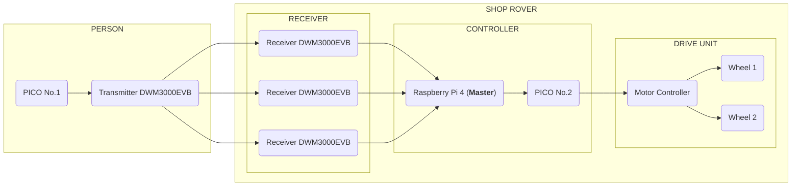

## Systemarchitektur

### Raspberry Pi - Zentral Steuerung

- LiDAR-Messwerte verarbeiten
- Position der Person anhand der UWB-Daten bestimmen
- Bewegungs- und Lenkvorgaben berechnen
- Hindernisse erkennen und beurteilen, ob eine Bewegung sicher ist
- Bewegungsbefehle an den Pi Pico senden

### Pi Pico - Motorsteuerung

- Motorgeschwindigkeit und Lenkung steuern
- Bewegungsbefehle des Raspberry Pi ausführen
- Kommunikations-Timeouts und den Zustand der Steuerung überwachen

### UWB
- misst Distanz zum Tag
- übergibt Distanz zum Raspberry Pi
- einer Konfiguert den Tag

## Übersicht Architektur

