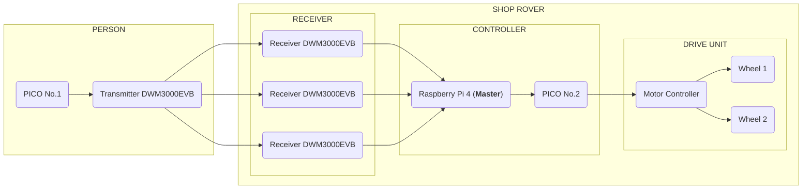

# UWB – Personenverfolgung im Shoprover

## 1. Was ist UWB?

UWB steht für *Ultra-Wideband* und ist eine Funktechnologie, mit der Geräte ihre Entfernung zueinander anhand der Laufzeit von Funksignalen bestimmen können.

Im Shoprover wird UWB verwendet, um eine zugewiesene Person zu verfolgen und den Roboter beim Einkaufen autonom hinter ihr herfahren zu lassen.

## 2. Wie funktioniert UWB im Shoprover?

Die Person trägt einen UWB-Tag. Das System ermittelt die Entfernung und, abhängig von der Konfiguration, die Richtung beziehungsweise relative Position der Person.

Der Raspberry Pi verarbeitet diese Daten und berechnet die Bewegungsbefehle. Der ESP32 steuert daraufhin die Motoren.

Eine einzelne Entfernungsmessung liefert keine eindeutige Richtung. Dafür sind zusätzliche Messungen oder geeignete Verfahren zur Richtungsbestimmung erforderlich.

## 3. Warum UWB?

UWB eignet sich für unseren Anwendungsfall, da es präzise Entfernungsmessungen ermöglicht und für die Positionsbestimmung in Innenräumen eingesetzt werden kann.

Durch den zugewiesenen Tag kann das System gezielt die Person verfolgen, die den Roboter benutzen möchte. Dies ist besonders wichtig, wenn sich mehrere Menschen in der Umgebung befinden.

UWB ist nicht alternativlos, stellt aber einen vielversprechenden Ansatz für die zuverlässige Personenverfolgung dar.

## 4. Welche Alternativen gibt es?

| Technologie | Vorteile | Nachteile |
|---|---|---|
| **UWB** | Präzise Entfernungsmessung, für Innenräume geeignet | Richtungsbestimmung benötigt zusätzliche Verfahren |
| **Bluetooth (BLE)** | Günstig und weit verbreitet | Entfernungsschätzung häufig ungenauer |
| **Kamera** | Kann Personen visuell erkennen und verfolgen | Abhängig von Beleuchtung und Sichtverhältnissen |
| **GPS** | Positionsbestimmung im Freien | In Innenräumen meist unzuverlässig |

Die Auswahl muss anhand der Genauigkeit, Zuverlässigkeit, Kosten und Integrationsmöglichkeiten bewertet werden.

## 5. Schnittstellen

Für das UWB-basierte Personentracking werden **Qorvo DWM3000EVB** verwendet. Die UWB-Module werden über einen **ESP32** angesteuert. Ein **Raspberry Pi 4** übernimmt die Verarbeitung der Messdaten und die Einbindung in ROS.

Das DWM3000 basiert auf dem DW3110 und unterstützt Ultra-Wideband-Kommunikation.

### 5.1 Hardware und Kommunikation

- **UWB-Tag:** Wird von der zu verfolgenden Person getragen und dient als Referenz für die Entfernungsmessung.
- **UWB-Module (Qorvo DWM3000EVB):** Tauschen UWB-Signale mit dem Tag aus, um die Entfernung zwischen Tag und Modul zu bestimmen.
- **ESP32:** Steuert die UWB-Module, verarbeitet die Messabläufe und stellt die ermittelten Messdaten bereit.
- **Raspberry Pi 4:** Empfängt die Messdaten vom ESP32, wertet sie aus und stellt sie den entsprechenden ROS-Komponenten zur Verfügung.

Die Kommunikation zwischen DWM3000EVB und ESP32 erfolgt über **SPI**. Für die Übertragung der Messdaten vom ESP32 zum Raspberry Pi kann eine serielle Verbindung verwendet werden, über ein USB Hub.

Die übertragenen Daten sollten mindestens die gemessene Entfernung, einen Zeitstempel und einen Status zur Gültigkeit der Messung enthalten.

### 5.2 Entfernung und relative Position

Für die UWB-basierte Personenerkennung werden drei UWB-Module am Rover installiert. Zwei Module befinden sich an den vorderen Ecken, während das dritte Modul mittig an der Rückseite angebracht wird. Die zu verfolgende Person trägt einen UWB-Tag.

Jedes Modul misst die Entfernung zum UWB-Tag anhand der Laufzeit der Funksignale (Time of Flight). Durch die Kombination der drei Entfernungsmessungen und der bekannten Positionen der Module am Rover kann die relative Position der Person geschätzt werden.

Die räumliche Anordnung der drei Module soll eine möglichst zuverlässige Positionsbestimmung aus unterschiedlichen Richtungen ermöglichen. Die tatsächliche Genauigkeit hängt unter anderem von der Montageposition, der Messqualität und den Umgebungsbedingungen ab.

### 5.3 Zuverlässigkeit der UWB-Messungen

Die Genauigkeit und Stabilität der UWB-Messungen hängen von den Umgebungsbedingungen ab. Insbesondere Wände, Möbel, Personen und metallische Gegenstände können die Signalausbreitung beeinflussen. Bei fehlender direkter Sichtverbindung zwischen Tag und Modul (*Non-Line-of-Sight*, NLOS) können fehlerhafte oder ungenauere Entfernungen auftreten.

Für die Bewertung der Zuverlässigkeit kann die wissenschaftliche Arbeit [*Omni-directional person tracking on a flying robot using occlusion-robust ultra-wideband signals*](https://ieeexplore.ieee.org/abstract/document/7759054) als Referenz dienen. Die dort beschriebenen Ergebnisse müssen jedoch unter den Bedingungen des Shoprover-Projekts überprüft werden.

Die Messungen sollen in unterschiedlichen Innenräumen getestet und mit bekannten Referenzabständen beziehungsweise Referenzpositionen verglichen werden. Erst anhand dieser Tests können realistische Aussagen zur erreichbaren Genauigkeit getroffen werden.

### 5.4 Verarbeitung und Filterung der Messdaten

Die vom ESP32 übertragenen Messwerte werden auf dem Raspberry Pi auf Gültigkeit und Aktualität geprüft. Dabei sind insbesondere folgende Punkte zu berücksichtigen:

- Erkennung veralteter oder ausbleibender Messwerte anhand von Zeitstempeln.
- Erkennung unplausibler Entfernungen und plötzlicher Positionssprünge.
- Kennzeichnung ungültiger Messungen, damit diese nicht ungeprüft in die Positionsbestimmung einfließen.
- Glättung schwankender Messwerte, beispielsweise mithilfe eines geeigneten Filters wie eines Kalman-Filters.

Die Filterparameter und Grenzwerte müssen anhand praktischer Messungen festgelegt werden.

### 5.5 Verhalten bei ungültigen UWB-Daten

Wenn keine zuverlässigen UWB-Messdaten vorliegen, muss die Person als **nicht zuverlässig lokalisiert** behandelt werden. Veraltete, fehlende oder ungültige Messwerte dürfen nicht als aktuelle Positionsinformation verwendet werden.

Sobald wieder ausreichend zuverlässige Messdaten verfügbar sind, kann die Positionsbestimmung fortgesetzt werden. Die Kriterien für gültige Messungen und die erforderlichen Zeitlimits müssen im Rahmen der Tests festgelegt werden.

## 6. Quellen und weiterführende Recherche

- [UWBTracking: Passive Human Tracking Under LOS/NLOS Scenarios Using IR-UWB Radar](https://ieeexplore.ieee.org/abstract/document/10538051)
- [UWB/INS Integrated Pedestrian Positioning for Robust Indoor Environments](https://ieeexplore.ieee.org/abstract/document/9104691)
- [Omni-directional person tracking on a flying robot using occlusion-robust ultra-wideband signals](https://ieeexplore.ieee.org/abstract/document/7759054)
- [GitHub – uwb_tracker_ros](https://github.com/eth-ait/uwb_tracker_ros)
- [GitHub – Real-Time Indoor Position Tracking System](https://github.com/DhamuVkl/ESP32-DWM3000-UWB-Indoor-RTLS-Tracker)
- [YouTube – Omni-directional person tracking using occlusion-robust UWB signals](https://www.youtube.com/watch?v=1gzw-V8Xmo0)
- [YouTube – How to build an Indoor Position Tracker using ESP32 and Qorvo UWB DWM3000](https://www.youtube.com/watch?v=tU45avfoSFU)
