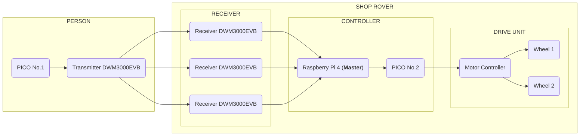

# UWB – Personenverfolgung im Shoprover

## 1. Was ist UWB?

UWB steht für *Ultra-Wideband* und ist eine Funktechnologie, mit der Geräte ihre Entfernung zueinander anhand der Laufzeit von Funksignalen bestimmen können.

Im Shoprover wird UWB verwendet, um eine zugewiesene Person zu verfolgen und den Roboter beim Einkaufen autonom hinter ihr herfahren zu lassen.

## 2. Wie funktioniert UWB im Shoprover?

Die Person trägt einen UWB-Tag. Drei UWB-Receiver am Rover messen die Entfernung zum Tag. Durch die Kombination dieser Messungen kann die relative Position der Person geschätzt werden.

Der Raspberry Pi 4 verarbeitet die UWB-Messdaten und bindet die Positionsbestimmung in ROS ein. Die Kommunikation mit den drei Receivern erfolgt direkt über SPI. Ein Raspberry Pi Pico wird für die UWB-Kommunikation auf der Tag-Seite verwendet.

Eine einzelne Entfernungsmessung liefert keine eindeutige Richtung. Dafür sind mehrere Messungen und ein geeignetes Verfahren zur Positionsbestimmung erforderlich.

Eine einzelne Entfernungsmessung liefert keine eindeutige Richtung. Dafür sind zusätzliche Messungen oder geeignete Verfahren zur Richtungsbestimmung erforderlich.

## 3. Warum UWB?

UWB eignet sich für unseren Anwendungsfall, da es präzise Entfernungsmessungen ermöglicht und für die Positionsbestimmung in Innenräumen eingesetzt werden kann.

Durch den zugewiesenen Tag kann das System gezielt die Person verfolgen, die den Roboter benutzen möchte. Dies ist besonders wichtig, wenn sich mehrere Menschen in der Umgebung befinden.

UWB ist nicht alternativlos, stellt aber einen vielversprechenden Ansatz für die zuverlässige Personenverfolgung dar.

## 4. Welche Alternativen gibt es?

| Technologie | Vorteile | Nachteile |
|---|---|---|
| **UWB** | Präzise Entfernungsmessung, für Innenräume geeignet | Richtungsbestimmung benötigt zusätzliche Verfahren |
| **Bluetooth (BLE)** | Günstig und weit verbreitet | Entfernungsschätzung häufig ungenauer |
| **Kamera** | Kann Personen visuell erkennen und verfolgen | Abhängig von Beleuchtung und Sichtverhältnissen |
| **GPS** | Positionsbestimmung im Freien | In Innenräumen meist unzuverlässig |

Die Auswahl muss anhand der Genauigkeit, Zuverlässigkeit, Kosten und Integrationsmöglichkeiten bewertet werden.

## 5. Schnittstellen

Für das UWB-basierte Personentracking werden **Qorvo DWM3000EVB** verwendet. Die drei UWB-Receiver am Rover sind direkt über **SPI mit dem Raspberry Pi 4** verbunden. Der Raspberry Pi übernimmt die Verarbeitung der Messdaten und die Einbindung in ROS.

Auf der Tag-Seite wird ein **Raspberry Pi Pico** zur Ansteuerung des UWB-Moduls verwendet.

### 5.1 Hardware und Kommunikation

- **UWB-Transmitter (Qorvo DWM3000EVB):** Wird zusammen mit dem Raspberry Pi Pico auf der Tag-Seite verwendet und sendet beziehungsweise verarbeitet die UWB-Signale entsprechend der implementierten Kommunikation.
- **Drei UWB-Receiver (Qorvo DWM3000EVB):** Sind am Rover installiert und messen die Entfernung zum UWB-Tag.
- **Raspberry Pi Pico:** Steuert das UWB-Modul auf der Tag-Seite.
- **Raspberry Pi 4:** Kommuniziert direkt über SPI mit den drei UWB-Receivern, verarbeitet deren Messdaten und stellt sie den entsprechenden ROS-Komponenten zur Verfügung.

Die Kommunikation zwischen dem Raspberry Pi 4 und den drei DWM3000EVB-Receivern erfolgt über SPI. Dabei müssen die Receiver eindeutig adressierbar sein, beispielsweise über separate Chip-Select-Leitungen. Zusätzlich sind die benötigten Interrupt- und Reset-Leitungen bei der Hardwareplanung zu berücksichtigen.

Die Messdaten der Receiver werden auf dem Raspberry Pi 4 zusammengeführt. Sie sollten mindestens die gemessene Entfernung, einen Zeitstempel und einen Status zur Gültigkeit der Messung enthalten.

### 5.2 Entfernung und relative Position

Für die UWB-basierte Personenerkennung werden drei UWB-Receiver am Rover installiert. Zwei Receiver befinden sich an den vorderen Ecken, während der dritte Receiver mittig an der Rückseite angebracht wird. Die zu verfolgende Person trägt einen UWB-Tag.

Jeder Receiver misst die Entfernung zum UWB-Tag anhand der Laufzeit der Funksignale (*Time of Flight*). Durch die Kombination der drei Entfernungsmessungen und der bekannten Positionen der Receiver am Rover kann die relative Position der Person geschätzt werden.

Die räumliche Anordnung der drei Receiver soll eine möglichst zuverlässige Positionsbestimmung aus unterschiedlichen Richtungen ermöglichen. Die tatsächliche Genauigkeit hängt unter anderem von der Montageposition, der Messqualität und den Umgebungsbedingungen ab.

Da drei Entfernungsmessungen nicht in jeder Situation eine eindeutige Position garantieren, müssen die Positionsbestimmung und mögliche Mehrdeutigkeiten praktisch getestet werden.

### 5.3 Zuverlässigkeit der UWB-Messungen

Die Genauigkeit und Stabilität der UWB-Messungen hängen von den Umgebungsbedingungen ab. Insbesondere Wände, Möbel, Personen und metallische Gegenstände können die Signalausbreitung beeinflussen. Bei fehlender direkter Sichtverbindung zwischen Tag und Receiver (*Non-Line-of-Sight*, NLOS) können fehlerhafte oder ungenauere Entfernungen auftreten.

Für die Bewertung der Zuverlässigkeit kann die wissenschaftliche Arbeit [*Omni-directional person tracking on a flying robot using occlusion-robust ultra-wideband signals*](https://ieeexplore.ieee.org/abstract/document/7759054) als Referenz dienen. Die dort beschriebenen Ergebnisse müssen jedoch unter den Bedingungen des Shoprover-Projekts überprüft werden.

Die Messungen sollen in unterschiedlichen Innenräumen getestet und mit bekannten Referenzabständen beziehungsweise Referenzpositionen verglichen werden. Erst anhand dieser Tests können realistische Aussagen zur erreichbaren Genauigkeit getroffen werden.

### 5.4 Verarbeitung und Filterung der Messdaten

Die vom Raspberry Pi 4 über SPI erfassten Messwerte werden auf Gültigkeit und Aktualität geprüft. Dabei sind insbesondere folgende Punkte zu berücksichtigen:

- Erkennung veralteter oder ausbleibender Messwerte anhand von Zeitstempeln.
- Erkennung unplausibler Entfernungen und plötzlicher Positionssprünge.
- Kennzeichnung ungültiger Messungen, damit diese nicht ungeprüft in die Positionsbestimmung einfließen.
- Glättung schwankender Messwerte, beispielsweise mithilfe eines geeigneten Filters wie eines Kalman-Filters.

Die Filterparameter und Grenzwerte müssen anhand praktischer Messungen festgelegt werden.

### 5.5 Verhalten bei ungültigen UWB-Daten

Wenn keine zuverlässigen UWB-Messdaten vorliegen, muss die Person als **nicht zuverlässig lokalisiert** behandelt werden. Veraltete, fehlende oder ungültige Messwerte dürfen nicht als aktuelle Positionsinformation verwendet werden.

Sobald wieder ausreichend zuverlässige Messdaten verfügbar sind, kann die Positionsbestimmung fortgesetzt werden. Die Kriterien für gültige Messungen und die erforderlichen Zeitlimits müssen im Rahmen der Tests festgelegt werden.

## 6. Quellen und weiterführende Recherche

- [UWBTracking: Passive Human Tracking Under LOS/NLOS Scenarios Using IR-UWB Radar](https://ieeexplore.ieee.org/abstract/document/10538051)
- [UWB/INS Integrated Pedestrian Positioning for Robust Indoor Environments](https://ieeexplore.ieee.org/abstract/document/9104691)
- [Omni-directional person tracking on a flying robot using occlusion-robust ultra-wideband signals](https://ieeexplore.ieee.org/abstract/document/7759054)
- [GitHub – uwb_tracker_ros](https://github.com/eth-ait/uwb_tracker_ros)
- [GitHub – Real-Time Indoor Position Tracking System](https://github.com/DhamuVkl/ESP32-DWM3000-UWB-Indoor-RTLS-Tracker)
- [YouTube – Omni-directional person tracking using occlusion-robust UWB signals](https://www.youtube.com/watch?v=1gzw-V8Xmo0)
- [YouTube – How to build an Indoor Position Tracker using ESP32 and Qorvo UWB DWM3000](https://www.youtube.com/watch?v=tU45avfoSFU)
