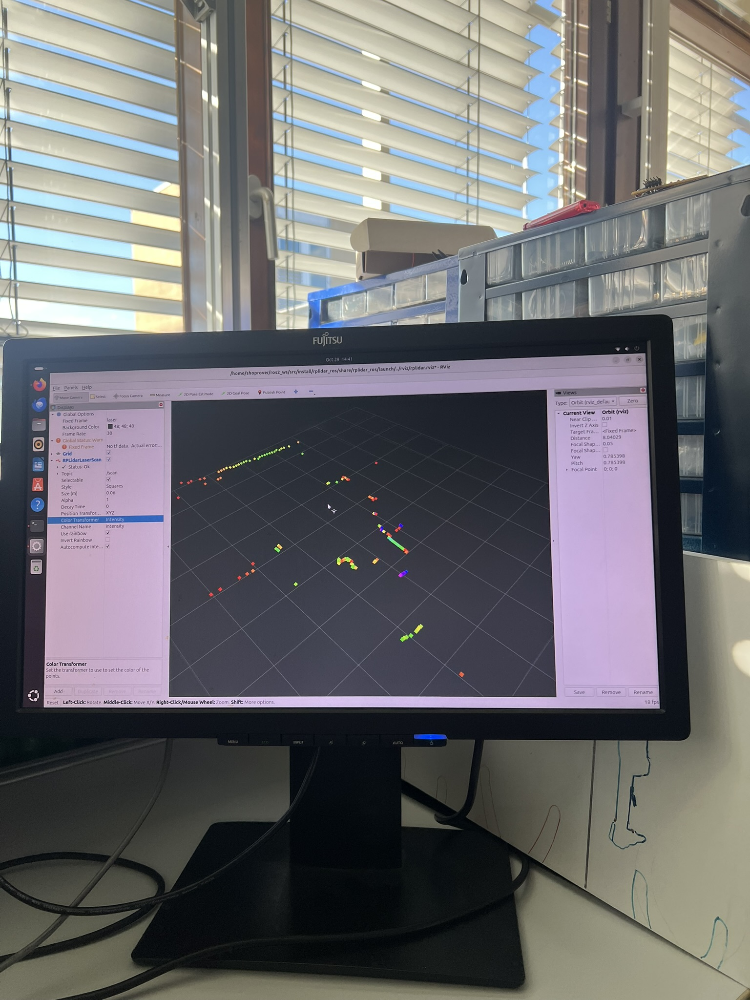
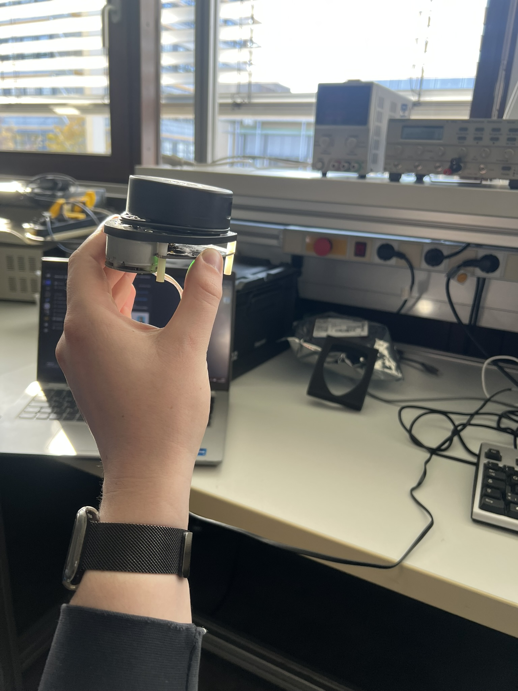

RPLIDAR ROS 2 Package
---

ROS node and test application for RPLIDAR

Visit following Website for more details about RPLIDAR:

rplidar roswiki: http://wiki.ros.org/rplidar

rplidar HomePage:   http://www.slamtec.com/en/Lidar

rplidar SDK: https://github.com/Slamtec/rplidar_sdk

rplidar Tutorial:  https://github.com/robopeak/rplidar_ros/wiki

> [!NOTE]
> Dieses Projekt verwendet das ROS-Paket [`rplidar_ros`](https://github.com/allenh1/rplidar_ros), das aus dem ursprünglichen Repository geklont wurde.

---
## Compile & Install rplidar_ros package

1. rplidar_ros in ros2 workspace hinzufügen 

   z.b (ros2_ws/src/rplidar_ros)

   ```bash
   mv rplidar_ros/ ~/ros2_ws/src/
   ```

2. Build rpidar_ros package

   Package muss vom Root Verzeichnis des **ros2_ws** gebaut werden mit folgendem Befehl:

   ```bash
   cd ~/ros2_ws/
   colcon build --symlink-install
   ```

3. Package in ros2 hinzufügen

    ```bash
    source ./install/setup.bash
    ```

    Note: Um Package dauerhaft in ros2 hinzuzufügen in bashrc einfügen:

    ```bash
    $echo "source ~/ros2_ws/install/setup.bash" >> ~/.bashrc
    $source ~/.bashrc
    ```

4. Rechte freigeben um auf LiDAR zuzugreifen

   Für den Betrieb von rplidar_ros benötigt der serielle Geräteanschluss Lese- und Schreibberechtigungen.

   Du kannst die Berechtigungen manuell mit folgendem Befehl anpassen:

   ```bash
   sudo chmod 777 /dev/ttyUSB0
   ```

# Package

1. Starte rplidar node und zeige es in rviz an.

    ```bash
    ros2 launch rplidar_ros view_rplidar.launch.py
    ```

2. Run rplidar node and view using test application
   ```bash
   ros2 launch rplidar_ros rplidar.launch.py
   ``` 
   oder 
   ```bash
   ros2 run rplidar_ros rplidar_composition
   ```

---



